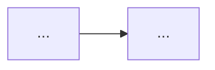

## What

<!-- One paragraph. Link the issue. -->

## Why

## Design

- [ ] Plan grilled with `/grill-plan`; "Design decisions" linked or below
- [ ] Not needed: no new agent, broker action, policy widening, prompt or schema change, model choice or architectural decision

<!-- architecture:start -->

## Architecture and data flow

<!-- Filled in by the /ship skill (.claude/skills/ship/SKILL.md). Required on every PR except
     Dependabot's; .github/workflows/pr-architecture.yml checks it. Diagrams in Mermaid, drawn
     from the code against docs/architecture/data-flow.md, changes marked. -->

### Before

### After

Data flow: changed (data-flow.md updated) | unchanged: <reason>

### Security

| Aspect                             | Change | Effect | Control |
| ---------------------------------- | ------ | ------ | ------- |
| Trust boundaries                   |        |        |         |
| Credentials and secrets            |        |        |         |
| Untrusted input and models         |        |        |         |
| Authority (policy, actions, repos) |        |        |         |
| Approvals and kill switch          |        |        |         |
| CI, supply chain, deploy           |        |        |         |
| Access and public routes           |        |        |         |

### Documentation

- [ ] docs/architecture/data-flow.md

<!-- architecture:end -->

## Security impact

- [ ] No change to what any agent may do (policy, actions, repos, tokens, bindings)
- [ ] Changes agent capabilities → policy diff reviewed, threat model section updated (`/threat-model`)
- [ ] Touches untrusted input handling (issue text, PR diffs, email, webhook) → wrapped with `untrusted()`, output schema-validated
- [ ] Touches secrets, Access, Terraform or CI → second reviewer requested

## How it was tested

<!-- Unit tests, `pnpm check`, evals run, preview version, manual steps -->

## AI assistance

<!-- Which skills/agents produced this? (e.g. /new-agent, security-reviewer). Reviewers read AI-generated code with the same care as any other. -->
