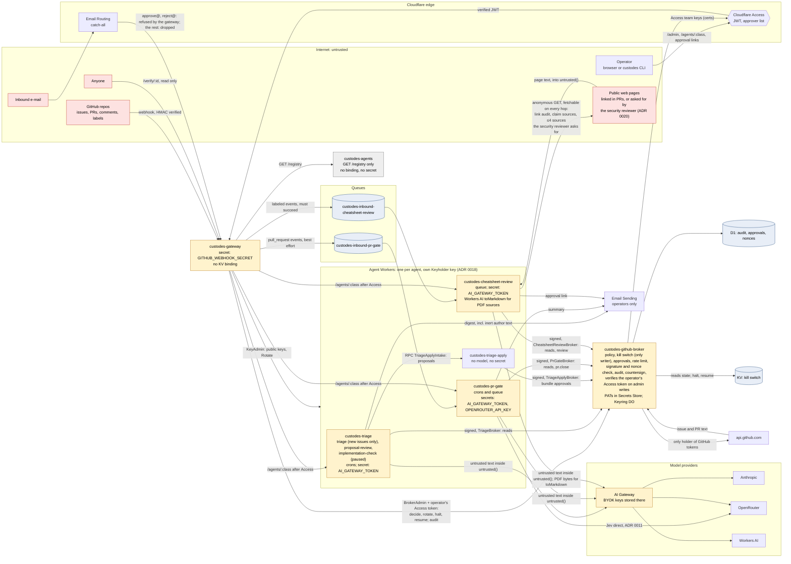

# Data flow

The current data flow of Custodes, with its trust boundaries and where every credential lives. It is
the reference the `/ship-pr` skill compares a pull request against: every pull request shows the part
of this diagram it touches, before and after, and updates this file when the flow changes
(`docs/sdlc.md`, `.github/workflows/pr-architecture.yml`). Derived from the Workers' `wrangler.jsonc` files, the broker policy and the
gateway routes, not from memory; when they disagree, the code is right and this file is stale.

Last checked against the code: 2026-11-25 (#143, ADR 0024: approval bundles for pull requests,
`issue.close` and `issue.unassign`, the people and comment rules in the broker's `act()` with a
thread read through the agent's read policy, GitHub writes never follow redirects; no new Worker,
binding, edge or secret). Before that, 2026-11-23 (#139, ADR 0022: `policy.json` gains a declared `tier`
per agent and a CI-only ceiling, `boundary.json`; no runtime flow changes). Before that, 2026-11-19 (#155, cheatsheet-review 0.3.0: the public web pages the
agent fetches are drawn, including the sources its security reviewer asks for (ADR 0020); the size
facts no longer read the default branch. Before that, 2026-11-18: tombstones, the `isolated` policy
flag and the cutover workflow removed; triage keeps to new issues; the digest carries the author's
inert text).

## The whole system

Legend: red = untrusted input, yellow = holds a credential, blue = stored state, grey = holds
nothing. Every arrow into a model carries untrusted GitHub text wrapped in `untrusted()`, and every
answer goes through `parseStructured()` (CLAUDE.md invariant 2).

## Trust boundaries

| #   | Boundary                       | What crosses it                                                                                                                                    | Control                                                                                                                                                                                                                                                                       |
| --- | ------------------------------ | -------------------------------------------------------------------------------------------------------------------------------------------------- | ----------------------------------------------------------------------------------------------------------------------------------------------------------------------------------------------------------------------------------------------------------------------------- |
| TB1 | Internet → gateway             | webhooks, operator requests, `/verify`                                                                                                             | webhook HMAC; Cloudflare Access JWT and approver list for `/admin` and `/agents`; service tokens may only trigger run, digest or summary                                                                                                                                      |
| TB2 | gateway → agent Workers        | queued webhook fields (no bodies), operator requests                                                                                               | `queuedFields()` minimises payloads; the consumer re-checks repo, label and sender (`route()`); unknown classes are a 404 (no fallback)                                                                                                                                       |
| TB3 | agent Worker → broker          | action and read requests, approval requests                                                                                                        | Ed25519 signature by the Worker's own key, nonce, per-Worker entrypoint admits only its agent ids; the default entrypoint refuses everything                                                                                                                                  |
| TB4 | broker → GitHub                | writes and reads                                                                                                                                   | policy (`policy.json`), kill switch, approvals, rate limits, audit record countersigned; PATs only here; comments: people rule (thread + policy `maintainers`, text only) and comment rules on every path, trigger-label daily cap (ADR 0024); writes never follow a redirect |
| TB5 | GitHub text → model            | issue, PR and comment text; public web pages cheatsheet-review fetched (PR links, claim sources, sources its security reviewer asks for, ADR 0020) | `untrusted()` envelopes, `parseStructured()` with zod, injection evals; fetches: `fetchable` on every hop (https, public DNS, not `custodes.work`, `api.github.com` or `*.workers.dev`), no credentials; pass 2 can only add findings                                         |
| TB6 | agent Worker → e-mail          | digests, summaries, approval links                                                                                                                 | `send_email` `allowed_destination_addresses` = the gateway's `APPROVER_EMAILS` (`bindings.test.ts`)                                                                                                                                                                           |
| TB7 | operator click → broker action | approval decision                                                                                                                                  | link token bound to the action hash, single use; decided only on `BrokerAdmin` (gateway only), which verifies the approver's own Access token itself (#104); the broker re-checks the snapshot (issue, or pull request with head SHA and reviews, ADR 0024)                   |

## Where each credential lives

| Credential                                 | Holder                                                                            | Used for                            |
| ------------------------------------------ | --------------------------------------------------------------------------------- | ----------------------------------- |
| GitHub PATs (`PAT_*`, Secrets Store)       | custodes-github-broker only                                                       | every GitHub read and write         |
| Broker Keyring (Ed25519, approval HMAC)    | custodes-github-broker (Durable Object)                                           | countersigning audit records, links |
| Agent keys (Ed25519, Keyholder)            | each agent Worker, its own                                                        | signing its broker calls            |
| `AI_GATEWAY_TOKEN`                         | custodes-triage, -pr-gate, -cheatsheet-review                                     | calling AI Gateway                  |
| `OPENROUTER_API_KEY`                       | custodes-pr-gate only                                                             | Jev, direct (ADR 0011)              |
| Provider keys (BYOK)                       | AI Gateway                                                                        | Anthropic, OpenRouter               |
| `GITHUB_WEBHOOK_SECRET`                    | custodes-gateway                                                                  | verifying webhooks                  |
| Kill switch (KV, write)                    | custodes-github-broker only (the gateway asks it with the operator's token; #104) | halt and resume                     |
| CI: Cloudflare deploy token, Anthropic WIF | GitHub Actions, `prod` environment                                                | deploys, Claude review and evals    |
