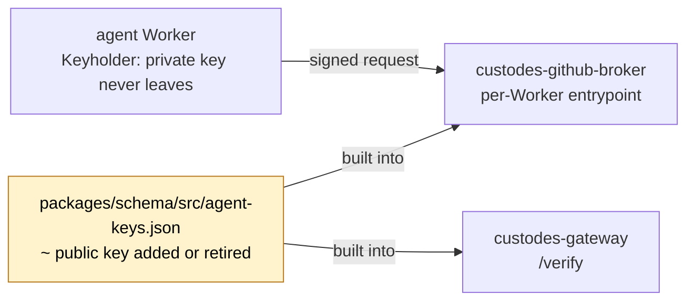

# Fixed architecture section for key-pin pull requests

A pull request from **Agent key pin** (`agent-key-pin.yml`) only adds or retires public keys in
`packages/schema/src/agent-keys.json`. Paste everything below the line into its body (the
`pr-architecture` check requires it; `.claude/skills/ship-pr/SKILL.md`), then replace the `Worker:` and
`kid:` placeholders (the check refuses them).

---

<!-- architecture:start -->

## Architecture and data flow

### Unchanged: where a pinned key is used

Worker: <custodes-...>, kid: <kid>

Data flow: unchanged: this pins a public key only; no Worker, binding, route, secret or grant changes.

### Security

| Aspect                             | Change                                                                  | Effect                         | Control                                                                                              |
| ---------------------------------- | ----------------------------------------------------------------------- | ------------------------------ | ---------------------------------------------------------------------------------------------------- |
| Trust boundaries                   | none                                                                    | same                           | n/a                                                                                                  |
| Credentials and secrets            | a public key is pinned or retired (no secret)                           | wider: a new signer is trusted | ADR 0018; `kid` and `x` compared with the Worker's own `keyholder.key.created` log line before merge |
| Untrusted input and models         | none                                                                    | same                           | n/a                                                                                                  |
| Authority (policy, actions, repos) | whoever holds the new private key gets that Worker's whole broker grant | wider: a new signer is trusted | ADR 0018; the grant itself is in `policy.json`, unchanged                                            |
| Approvals and kill switch          | none                                                                    | same                           | n/a                                                                                                  |
| CI, supply chain, deploy           | none                                                                    | same                           | n/a                                                                                                  |
| Access and public routes           | `/verify` checks this Worker's signatures                               | same                           | n/a                                                                                                  |

### Documentation

- [x] Not affected: a key pin changes no documented flow (`docs/runbooks/agent-cutover.md` step 3).

<!-- architecture:end -->
